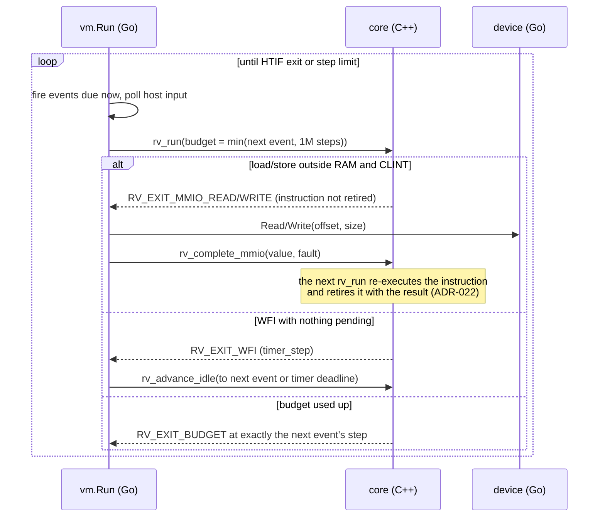

# rvsim architecture

> Started in Phase 4; completed in Phase 13. Decisions are recorded in
> [DECISIONS.md](DECISIONS.md).

## The split

| Layer | Language | Owns |
|---|---|---|
| `core/` | C++20 | Registers, CSRs, privilege, decode/execute, traps, physical RAM, the CLINT. Everything on the per-instruction path. |
| `vmm/machine` | Go (cgo) | A thin wrapper over the C ABI in `core/include/rv.h`. |
| `vmm/vm` | Go | The run loop: devices, scheduler, MMIO dispatch, HTIF, host input. |
| `vmm/devices/...` | Go | The bus registry, the PLIC and the 16550 UART. |
| `vmm/sched` | Go | The discrete-event scheduler in virtual time. |

## The run loop

The core runs until something needs the VMM, then returns an *exit*. Go never
crosses the boundary per instruction.

## Virtual time

Time is counted in **steps**. A step is a retired instruction, a taken trap, or
one unit of idle time skipped during WFI (ADR-001). The CLINT's `mtime` is
steps / `steps_per_tick` (default 10). Events fire at exact steps: the run
loop never asks the core to run past the next event. Host input enters only
through scheduled events (ADR-023), so the same inputs at the same steps give
the same execution.

## Memory map

| Region | Base | Size | Implemented in |
|---|---|---|---|
| Test finisher (power-off/reset) | `0x0010_0000` | 4 KiB | Go (ADR-026) |
| CLINT | `0x0200_0000` | 64 KiB | C++ (ADR-020) |
| PLIC | `0x0C00_0000` | 64 MiB | Go |
| UART (16550A), PLIC source 10 | `0x1000_0000` | 256 B | Go |
| virtio-mmio block device, PLIC source 1 (with a disk) | `0x1000_1000` | 4 KiB | Go (ADR-027) |
| RAM | `0x8000_0000` | 256 MiB default | C++ |

Any other physical address is an MMIO exit. If no device is mapped there, the
VMM completes it as an access fault.

## Booting Linux

`rvsim boot -firmware fw_jump.bin -kernel Image -initrd rootfs.cpio` boots
OpenSBI and Linux. `vmm/boot` loads the images:

- firmware at the start of RAM;
- the kernel at +2 MiB;
- the device tree at +34 MiB;
- the initramfs at the top of RAM.

It also describes the platform in a device tree, using `vmm/fdt` (ADR-026).

With `-disk rootfs.ext4` (and no initramfs) the root filesystem is ext4 on
a virtio block device. Requests complete in virtual time, as scheduled
events (ADR-027).

`make images` builds the images with Buildroot in a container. `make
linux` then boots them, runs commands at the BusyBox shell and powers off
through the test finisher.

## Determinism, replay and snapshots

Everything that reaches the guest from outside is recorded with the step at
which it arrived: UART input, end of input, and the images' hashes. A replay
therefore reproduces the session exactly. Checkpoints compare XXH3 hashes of
the core, RAM and VMM state every N steps (ADR-028; `docs/REPLAY.md`).
Snapshots save the whole machine at a run-loop boundary, and restoring one
continues exactly as the original would have (ADR-029).

## Boundary performance

These numbers are a Phase 4 baseline. They were measured on an Apple Silicon
laptop (8 cores, macOS 26, Go 1.27.2), with
`go test -bench MMIOExit -benchmem ./vmm/vm`. The guest polls the UART LSR in a
two-instruction loop, so every other step is a full MMIO round trip: an exit, the
bus dispatch, the UART register access, `rv_complete_mmio`, and the
re-executed instruction retiring.

| Measurement | Result |
|---|---|
| MMIO round trip inside a long run | **~102 ns/exit (~9.8 M exits/s), 0 allocations** |
| MMIO round trip with one `vm.Run` call per exit | ~144 ns/exit (~6.9 M exits/s), 0 allocations |
| Empty `rv_run` call (Phase 0) | ~31–57 ns |

For scale, a Linux 8250 driver writing one character costs about three exits.
That is roughly 0.3 µs of host time per character at these rates.
