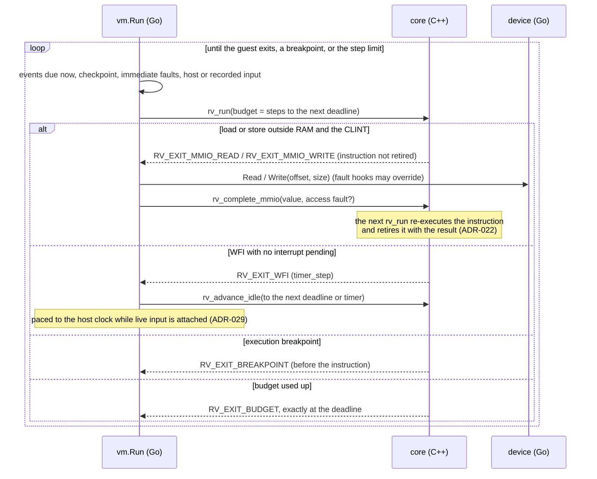

# rvsim architecture

> Started in Phase 4; completed in Phase 13. Decisions are recorded in
> [DECISIONS.md](DECISIONS.md).

## The split

| Layer | Language | Owns |
|---|---|---|
| `core/` | C++20 | Everything on the per-instruction path: registers, CSRs, privilege, decode and execute, traps, the Sv39 MMU and TLB, physical RAM and the CLINT. Also the state hashes, core snapshots, breakpoints and the decode cache. |
| `vmm/machine` | Go (cgo) | A thin wrapper over the C ABI in `core/include/rv.h`. |
| `vmm/vm` | Go | The run loop: MMIO dispatch, the scheduler, host input, HTIF, checkpoints, fault hooks and saving state. |
| `vmm/devices/...` | Go | The bus, the PLIC, the 16550 UART, the test finisher, and virtio-mmio with virtio-blk. |
| `vmm/sched` | Go | The discrete-event scheduler in virtual time. |
| `vmm/boot`, `vmm/fdt` | Go | Loading OpenSBI and Linux, and the generated device tree. |
| `vmm/replay`, `vmm/snapshot` | Go | Record/replay (`.rvrec`) and whole-machine snapshots (`.rvsnap`). |
| `vmm/gdb`, `vmm/fault` | Go | The GDB remote stub, and fault injection. |
| `cmd/rvsim` | Go | The CLI. |

## The run loop and the exit model

The core runs until something needs the VMM, then returns an *exit*. Go
never crosses the boundary per instruction. Each pass of the run loop
starts at a step boundary, in a fixed order (ADR-028, ADR-031):
1. fire the events due now;
2. take the checkpoint, if this step is one;
3. apply the immediate faults due now;
4. deliver input.

The loop never asks the core to run past its next deadline: the next event,
checkpoint, recorded input, due fault, or the run limit.



## Virtual time

Time is counted in **steps** (ADR-001). A step is one of:
- a retired instruction;
- a taken trap;
- one unit of idle time skipped during WFI.

The CLINT's `mtime` is steps / `steps_per_tick` (default 10; the device
tree's timebase is 10 MHz). Events fire at exact steps. External input
enters only at step boundaries, never while an MMIO access is in flight,
and at most once per step. Recordings capture each input with its step. The
same images, configuration and inputs therefore give the same execution,
which state-hash checkpoints verify (ADR-028).

## Memory map

| Region | Base | Size | Implemented in |
|---|---|---|---|
| Test finisher (power-off/reset) | `0x0010_0000` | 4 KiB | Go (ADR-026) |
| CLINT | `0x0200_0000` | 64 KiB | C++ (ADR-020) |
| PLIC | `0x0C00_0000` | 64 MiB | Go |
| UART (16550A), PLIC source 10 | `0x1000_0000` | 256 B | Go |
| virtio-mmio block device, PLIC source 1 (with a disk) | `0x1000_1000` | 4 KiB | Go (ADR-027) |
| RAM | `0x8000_0000` | 256 MiB default | C++ |

Any other physical address is an MMIO exit. If no device is mapped there, the
VMM completes it as an access fault.

## Booting Linux

`rvsim boot -firmware fw_jump.bin -kernel Image -initrd rootfs.cpio` boots
OpenSBI and Linux. `vmm/boot` loads the images:

- firmware at the start of RAM;
- the kernel at +2 MiB;
- the device tree at +34 MiB;
- the initramfs at the top of RAM.

It also describes the platform in a device tree, using `vmm/fdt` (ADR-026).

With `-disk rootfs.ext4` (and no initramfs) the root filesystem is ext4 on
a virtio block device. Requests complete in virtual time, as scheduled
events (ADR-027).

`make images` builds the images with Buildroot in a container. `make
linux` then boots them, runs commands at the BusyBox shell and powers off
through the test finisher.

## Determinism, replay and snapshots

Everything that reaches the guest from outside is recorded with the step at
which it arrived: UART input, end of input, and the images' hashes. A replay
therefore reproduces the session exactly. Checkpoints compare XXH3 hashes of
the core, RAM and VMM state every N steps (ADR-028; `docs/REPLAY.md`).
Snapshots save the whole machine at a run-loop boundary, and restoring one
continues exactly as the original would have (ADR-029).

## Fault injection

`-faults spec.yaml` injects faults at exact triggers or with seeded
probability: bit flips, registers, MMIO reads, interrupts, disk requests and
UART bytes. Each fault applied is logged and recorded, so faulty runs replay
exactly (ADR-031; `docs/FAULTS.md`).

## Debugging

`rvsim gdb` serves a live machine to GDB, and `rvsim replay -gdb` serves a
recording with `reverse-stepi` and `reverse-continue` (ADR-030):

```sh
rvsim gdb -at 20000000 -firmware build/images/fw_jump.bin -kernel build/images/Image -initrd build/images/rootfs.cpio
gdb-multiarch build/images/vmlinux -ex 'target remote localhost:1234' -ex 'break kernel_execve' -ex continue -ex bt
```

## Interpreter performance

Booting OpenSBI and Linux to the BusyBox shell takes about 1.3 s, 76 M
instructions at roughly 60–70 MIPS (`make perf`). The interpreter caches
decoded instructions by physical address and the current fetch page's
translation (ADR-032). Both are checked against RAM and the TLB generation,
so self-modifying code and `sfence.vma` behave exactly as without them.

## Boundary performance

The cost of crossing the C++/Go boundary is measured with
`go test -bench MMIOExit -benchmem ./vmm/vm`. The guest polls the UART LSR
in a two-instruction loop, so every other step is a full MMIO round trip:
- an exit;
- the bus dispatch and the UART register access;
- `rv_complete_mmio`;
- the re-executed instruction retiring.

Measured on an Apple Silicon laptop (8 cores, macOS 26, Go 1.27.2):

| Measurement | Phase 4 | Phase 13 |
|---|---|---|
| MMIO round trip inside a long run | ~102 ns/exit (~9.8 M exits/s) | ~120–141 ns/exit (~7–8 M exits/s) |
| MMIO round trip with one `vm.Run` call per exit | ~144 ns/exit | ~172–184 ns/exit |
| Allocations per exit | 0 | 0 |
| Empty `rv_run` call (Phase 0) | ~31–57 ns | |

The run loop now does more at each boundary than it did in Phase 4:
checkpoint and fault checks, the input rules of ADR-028, flushing the trace
on return. The Phase 13 numbers were also taken on a busier machine. For
scale, a Linux 8250 driver writing one character costs about three exits:
under half a microsecond of host time.
